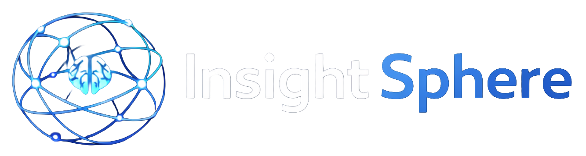

<p align="center">
  
</p>

# NexoraAI

**Governed enterprise AI workspace for knowledge, agents, integrations, and business workflows.**

NexoraAI helps organizations build and operate AI assistants over private
knowledge while controlling who can access each Agent, document scope, model,
integration, and tool. It supports Azure-managed services and a portable
Docker Compose data plane for on-premises or Azure VM deployments.

> The current stable release line is `2.2.x`. Enterprise federation, Agent
> Catalog, and related changes are being qualified for `2.3.0`; see the
> [release-readiness gate](docs/release-readiness-2.3.md).

## Product capabilities

### Agents and reusable workflows

- Legacy and LangGraph runtimes with RAG, tools, MCP, and delegated Agents.
- Team-owned Agents with model profiles, prompts, attachment policies, Data
  Groups, integrations, and tool allowlists.
- Governed Agent Catalog with immutable published versions, Team visibility,
  dependency metadata, and Team-local installation.
- Structured evidence workflows, including requirement-to-Knowledge compliance
  matrices with file/page citations.

### Enterprise knowledge

- Personal, Team, Global, and Data Group document scopes with backend-enforced
  authorization.
- Azure Blob/Data Lake or MinIO object storage.
- Azure AI Search or Qdrant vector retrieval.
- Azure OpenAI or OpenAI-compatible embedding profiles, including local Ollama
  and BGE-M3.
- Configurable document-processing and OCR providers with persistent jobs,
  retry/recovery, and source provenance.

### Integrations and MCP

- Unified Team integration catalog for REST APIs, read-only databases, mail,
  documents, messaging, and MCP servers.
- Multiple tenant-specific connections with Team assignment and Agent-level
  tool selection.
- Managed on-premises Azure MCP instances plus hosted MCP connections such as
  Draw.io and Datadog.
- Tool policy, argument validation, read-only database enforcement, and
  metadata-only execution audit.

### Identity, governance, and operations

- Local accounts, Microsoft Entra ID, managed OIDC, and managed SAML 2.0.
- Team roles and permissions, reviewed federated identity linking, and
  domain-restricted JIT provisioning.
- Hierarchical System → Team → Agent guardrails with prompt-injection,
  credential, PII/DLP, and content controls.
- Usage analytics, hierarchical quotas, retention cleanup, offline licensing,
  System Health, and metadata-only audit records.
- Validated MongoDB/MinIO/Qdrant backup and restore plus optional Nginx TLS
  ingress.

## Deployment modes

| Mode | Typical components |
| --- | --- |
| Azure managed | Azure OpenAI, Azure AI Search, Azure Storage, Cosmos DB, Entra ID |
| Self-hosted / Azure VM | Docker Compose, MongoDB, MinIO, Qdrant, Ollama, optional Nginx TLS |
| Hybrid | Mix Azure and local providers independently for models, storage, search, and identity |

## Architecture at a glance

```text
Users / External Identity Providers
                 │
          NexoraAI Portal/API
                 │
     ┌───────────┼────────────┐
     │           │            │
  Agents      Knowledge    Integrations
     │           │            │
 LLM profiles  Object +     REST / DB / MCP /
 & LangGraph   Vector store  Mail / Messaging
     └───────────┼────────────┘
                 │
      Policy, quota, audit, retention
```

## Quick start — portable Docker runtime

Requirements: Docker with Compose, sufficient memory/disk for the selected
models, and a protected environment file.

```bash
cp docs/local-runtime.env.example .env.local-runtime
# Replace every replace_with_* value and generate a stable Fernet key.

docker compose --env-file .env.local-runtime \
  -f docker-compose.local-runtime.yml \
  up -d --build --wait
```

Open `http://127.0.0.1:50505` for host-local setup. Before allowing remote
access, configure the documented TLS gateway or an equivalent enterprise
ingress. Never commit `.env.local-runtime`, certificates, API keys, license
signing keys, or `APP_DATA_ENCRYPTION_KEY`.

Full instructions: [Portable local runtime](docs/local-runtime.md) and
[Azure VM deployment](docs/azure-vm-docker-compose-deployment-guide.md).

## Documentation

| Area | Guide |
| --- | --- |
| Administration | [Administrator manual](docs/admin-manual.md) |
| End-user operation | [User manual](docs/user-manual.md) |
| Authentication | [Local, Entra, OIDC, and SAML](docs/local-authentication.md) |
| Agents | [Agent Catalog](docs/agent-catalog.md) |
| Integrations | [Integration control plane](docs/integration-control-plane.md) |
| Guardrails | [AI guardrails](docs/ai-guardrails.md) |
| Local deployment | [Portable runtime](docs/local-runtime.md) |
| Production ingress | [TLS and Nginx](docs/production-tls.md) |
| Backup and recovery | [Local backup and restore](docs/local-backup-restore.md) |
| Current engineering state | [Codex handoff](docs/CODEX_HANDOFF.md) |
| Product direction | [Product backlog](docs/product-backlog.md) |

The complete documentation index is available in [`docs/README.md`](docs/README.md).

## Development validation

Backend service-free regression:

```bash
.venv/bin/pytest -q --ignore=tests/test_app_config.py \
  -m 'not azure and not external and not data_integration'
```

Frontend production build:

```bash
cd app/frontend
npm run build:memory-safe
```

Do not run destructive restore or volume-removal commands against a deployment
that contains data. Follow the documented disposable restore-drill procedure.

## Security

Do not report vulnerabilities in public issues. Follow
[`SECURITY.md`](SECURITY.md) and use GitHub's private vulnerability reporting
channel. Production installations must use HTTPS, stable externally protected
encryption keys, least-privilege identities, private stateful services, tested
backups, and deployment-specific access policies.

## Provenance and license

NexoraAI was initially derived from Microsoft's
[`Azure-Samples/azure-search-openai-demo`](https://github.com/Azure-Samples/azure-search-openai-demo)
and has since been substantially extended into a governed multi-provider Agent
platform. The original copyright and MIT license are preserved. See
[`LICENSE`](LICENSE) and [`NOTICE.md`](NOTICE.md).
